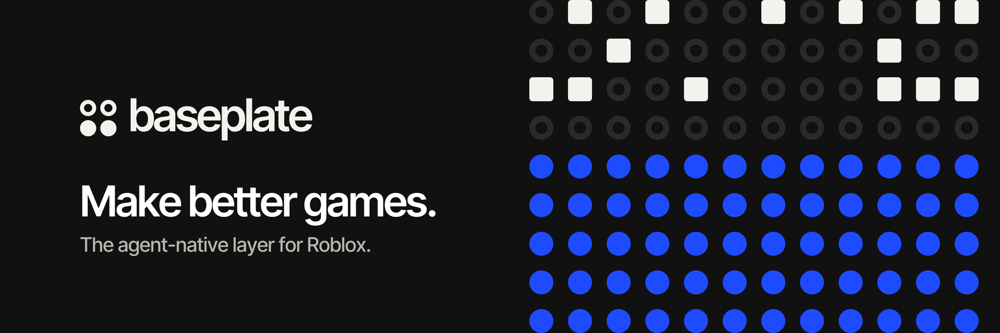

<p align="center">
  <a href="https://baseplatehq.github.io/baseplate/">
    
  </a>
</p>

<p align="center">
  <a href="https://baseplatehq.github.io/baseplate/"><b>Website</b></a> &nbsp;·&nbsp;
  <a href="https://baseplatehq.github.io/baseplate/library/"><b>Library</b></a> &nbsp;·&nbsp;
  <a href="https://baseplatehq.github.io/baseplate/docs/"><b>Docs</b></a> &nbsp;·&nbsp;
  <a href="https://www.npmjs.com/package/baseplate-cli"><b>npm</b></a>
</p>

<p align="center">
  <a href="https://www.npmjs.com/package/baseplate-cli"></a>
  <a href="LICENSE"></a>
  
</p>

<br>

Baseplate is an MCP server that gives your coding agent a library of **600 safety-scanned effects** and **906 game sounds** for Roblox, each with a plain name and a description. Set it up once, then ask for what you need in plain words. Your agent finds it, adds it and wires it in.

```
"Add a fire explosion when the rocket hits."
"Make collecting a coin feel rewarding."
```

<br>

## Get started

You need Node 18 or newer, a [Rojo](https://rojo.space) project, and the Roblox Studio MCP so your agent can load effects into your place.

**Connect your agent**

```bash
# Claude Code
claude mcp add baseplate -- npx -y baseplate-cli mcp
```

```toml
# Codex: ~/.codex/config.toml
[mcp_servers.baseplate]
command = "npx"
args = ["-y", "baseplate-cli", "mcp"]
```

```json
// Cursor: .cursor/mcp.json
{
  "mcpServers": {
    "baseplate": { "command": "npx", "args": ["-y", "baseplate-cli", "mcp"] }
  }
}
```

Then open your Rojo project with your agent and ask for something.

<br>

## How it works

| Step | What happens |
|---|---|
| **Find** | The agent calls `find_vfx` or `find_sfx` with plain words and gets back named components with one-line descriptions. |
| **Add** | It calls `add_vfx` or `add_sfx` with the names it picked. Effects are checked against their scanned version. Sounds are copied into your project. |
| **Play** | It writes one line of Luau with the Juice runtime. |

```lua
Juice.play("explosion/fire", part)
Juice.sfx("pickup/coin-3", part)
```

<br>

## Tools

| Tool | What it does |
|---|---|
| `find_vfx` | Searches 600 single effects by what they are for. Returns up to 5, each with its name, a description and the pack it comes from. |
| `add_vfx` | Confirms the pack is still the version Baseplate scanned, records it in a `vfx.json` lockfile, and returns one snippet for the Roblox Studio MCP. Refuses if the pack changed after its scan. |
| `find_sfx` | Searches 906 sounds. Each description is measured from the audio: length, tone or noise, pitch, rising or falling, hits. Returns up to 8. |
| `add_sfx` | Copies each sound into `assets/sounds/`, registers it in `Sounds.luau` and records it in `sfx.json`. Uploads to Roblox when `ROBLOX_API_KEY` and `ROBLOX_CREATOR` are set in your project's `.env`. |

Browse everything in the [library](https://baseplatehq.github.io/baseplate/library/), or read the full [docs](https://baseplatehq.github.io/baseplate/docs/).

<br>

## In this repository

This repository hosts what the CLI and the website read from.

| Path | What it is |
|---|---|
| [`docs/`](docs) | The website and the public registry (`docs/r/`) that the CLI fetches: component index, sounds and effect metadata. Served with GitHub Pages. |
| [`implementations/`](implementations) | Step-by-step build specs your agent can follow, one per game type: [core](implementations/core/IMPLEMENTATION.md), [obby](implementations/obby/IMPLEMENTATION.md), [simulator](implementations/simulator/IMPLEMENTATION.md) and [tycoon](implementations/tycoon/IMPLEMENTATION.md). |

<br>

## License and contact

Released under the [MIT license](LICENSE). Baseplate is not affiliated with Roblox Corporation.

Questions: [hello.baseplate@proton.me](mailto:hello.baseplate@proton.me)
